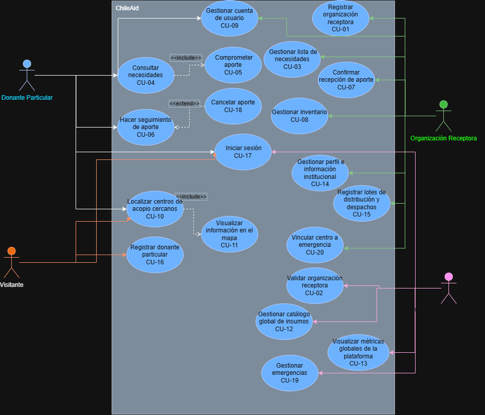
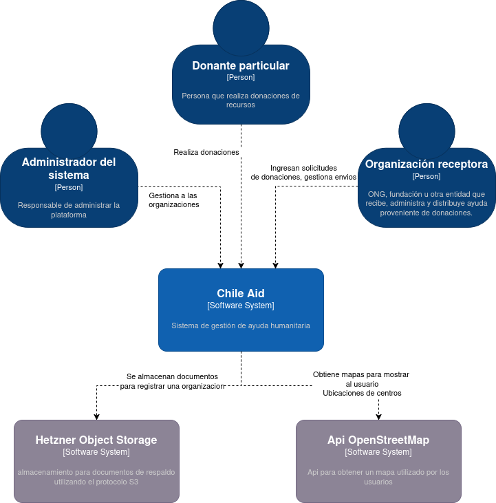
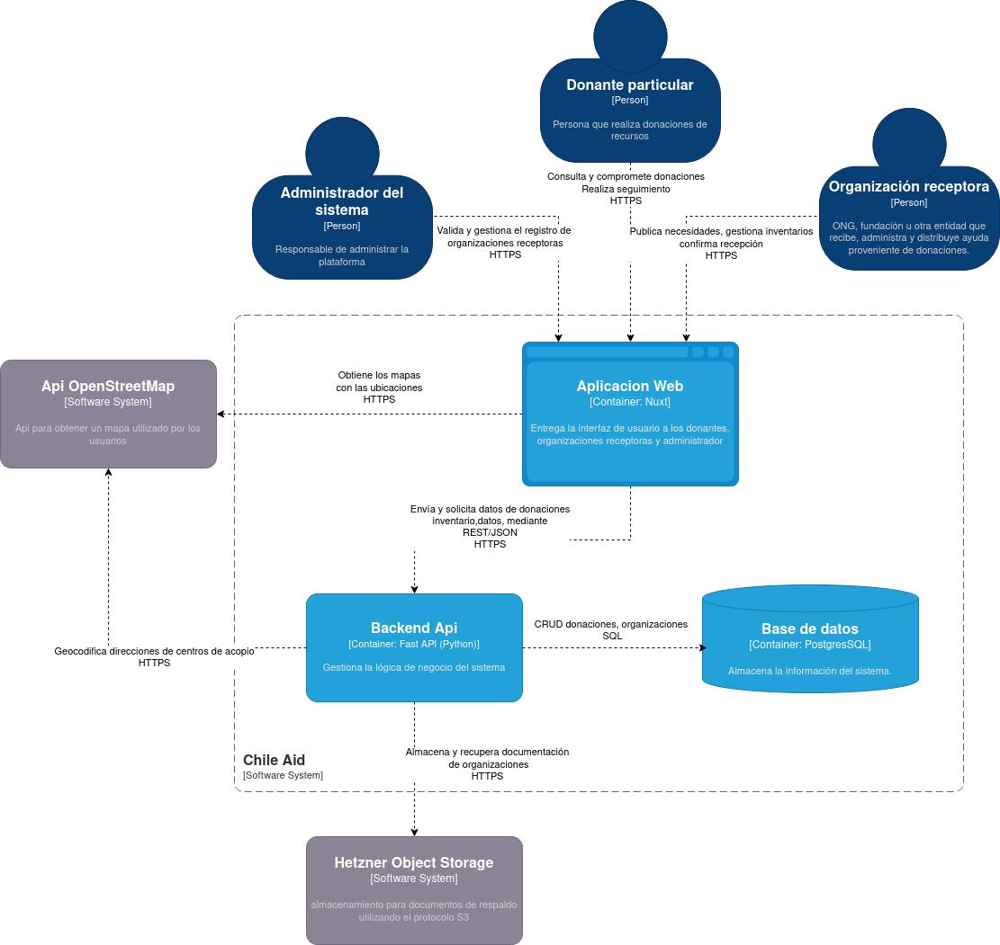

# ChileAid

Plataforma web de gestión de ayuda humanitaria que conecta donantes particulares con organizaciones receptoras durante emergencias y catástrofes en Chile.

## Documentación del proyecto

| Documento | Contenido |
|---|---|
| [Casos de Uso (CU.md)](documentación/CU.md) | Especificación completa de los 20 casos de uso (actores, flujos, pre/post condiciones) |
| [Casos de Prueba (TC.md)](documentación/TC.md) | Casos de prueba exitoso / negativo / límite derivados de los casos de uso |
| [Suite de pruebas (tests/README.md)](tests/README.md) | Pruebas de humo, integración y E2E: cómo correrlas y trazabilidad TC → test |

---

## Integrantes

- Camilo Rojas
- Armin Hucke
- Nicolás Llancaqueo
- Robin Vásquez
- Sebastián Yáñez

---

## Contexto y Problema

En emergencias chilenas (terremotos, incendios, aluviones), la solidaridad ciudadana se canaliza de forma informal y sin coordinación central. Esto genera tres problemas estructurales:

- **Duplicidad de suministros**: centros de acopio colapsados con artículos que ya no se necesitan.
- **Desinformación**: los donantes desconocen qué insumos son realmente urgentes.
- **Falta de trazabilidad**: nadie sabe si su aporte llegó a destino.

ChileAid actúa como puente ordenado entre organizaciones y donantes, con solicitudes verificadas, actualización en tiempo real y seguimiento individual de cada aporte.

---

## Atributos de Calidad

| Atributo | Escenario clave | Medida |
|---|---|---|
| **Disponibilidad** | El proceso del servidor cae durante una campaña activa | Reinicio automático en < 30 segundos vía PM2/systemd |
| **Comportamiento temporal** | 5–10 usuarios comprometen donaciones simultáneas sobre la misma necesidad | Actualización de barra de progreso en < 3 segundos; cero casos de sobrestock |
| **Usabilidad** | Donante sin experiencia intenta completar su primer aporte | El 80% completa el flujo sin ayuda externa ni errores que requieran reinicio |

---

## Tácticas Arquitectónicas

- **Disponibilidad**: Reinicio automático → Monitoreo activo → Degradación controlada
- **Comportamiento temporal**: Control de concurrencia → Caché de lecturas → Tasa de muestreo
- **Usabilidad**: Separación por rol → Feedback inmediato → Diseño orientado a tareas

---

## Requerimientos Funcionales

### Gestión de Usuarios y Accesos

| Código | Requerimiento |
|---|---|
| RF-01 | El sistema debe permitir el registro de nuevos donantes. |
| RF-02 | El sistema debe permitir el registro de organizaciones de ayuda (quedando en estado pendiente de aprobación). |
| RF-03 | El sistema debe permitir el inicio de sesión de usuarios registrados según su rol (Donante, Organización, Administrador). |
| RF-04 | El sistema debe permitir al donante y a la organización consultar y modificar sus datos de perfil y contacto. |

### Módulo del Donante (Público)

| Código | Requerimiento |
|---|---|
| RF-05 | El sistema debe permitir buscar y filtrar necesidades y centros operativos (por región, tipo, estado y prioridad). |
| RF-06 | El sistema debe mostrar en un mapa interactivo la ubicación georreferenciada de los centros operativos. |
| RF-07 | El sistema debe permitir al donante comprometer un aporte para una necesidad específica, generando un código de seguimiento único. |
| RF-08 | El sistema debe permitir al donante hacer seguimiento del estado de sus aportes comprometidos. |
| RF-09 | El sistema debe permitir al donante cancelar un aporte previamente comprometido que aún no ha sido entregado. |

### Módulo de la Organización

| Código | Requerimiento |
|---|---|
| RF-10 | El sistema debe permitir a la organización crear, editar y georreferenciar su centro operativo. |
| RF-11 | El sistema debe permitir a la organización vincular o desvincular su centro operativo a una emergencia activa. |
| RF-12 | El sistema debe permitir a la organización gestionar su catálogo de necesidades (crear, editar cantidad/urgencia, cerrar manualmente). |
| RF-13 | El sistema debe permitir a la organización confirmar la recepción física de un aporte utilizando el código de seguimiento del donante. |
| RF-14 | El sistema debe permitir a la organización registrar la salida (distribución) de lotes de insumos y calcular su stock disponible. |
| RF-15 | El sistema debe permitir a la organización subir y visualizar documentos de respaldo para su validación institucional. |

### Módulo del Administrador

| Código | Requerimiento |
|---|---|
| RF-16 | El sistema debe permitir al administrador verificar organizaciones (revisar documentos, aprobar, rechazar con motivo, desactivar). |
| RF-17 | El sistema debe permitir al administrador gestionar el catálogo global de insumos estándar. |
| RF-18 | El sistema debe permitir al administrador gestionar las emergencias (crear, listar activas, cerrar). |

### Automatizaciones y Métricas

| Código | Requerimiento |
|---|---|
| RF-19 | El sistema debe actualizar automáticamente la capacidad de una necesidad, bloqueando el sobrestock y cerrándola al llegar al 100% de la meta. |
| RF-20 | El sistema debe visualizar métricas agregadas en tiempo real para todos los actores (centros, donantes, aportes, emergencias). |

---

## Actores

| Código | Nombre | Rol |
|---|---|---|
| AC-01 | Donante Particular | Consulta necesidades, compromete aportes y hace seguimiento de su entrega |
| AC-02 | Organización Receptora | Publica necesidades, gestiona inventario y confirma recepción de insumos |
| AC-03 | Administrador del Sistema | Valida y gestiona las organizaciones registradas en la plataforma |
| AC-04 | Visitante | Usuario no autenticado que explora la landing y el mapa público de centros activos sin necesidad de iniciar sesión |

---

## Casos de Uso

> La especificación completa de cada caso (actores, precondiciones, flujo principal, flujos alternativos y postcondiciones) está en **[documentación/CU.md](documentación/CU.md)**; los casos de prueba derivados, en **[documentación/TC.md](documentación/TC.md)**.

| Código | Nombre | Descripción |
|---|---|---|
| CU-01 | Registrar organización receptora | La Organización ingresa sus datos y documentos para solicitar acceso a la plataforma, quedando en estado pendiente de aprobación. |
| CU-02 | Validar organización receptora | El Administrador del Sistema revisa los antecedentes de una organización y la aprueba, rechaza (indicando un motivo), desactiva o reactiva. |
| CU-03 | Gestionar lista de necesidades | La Organización Receptora crea, actualiza o cierra manualmente las solicitudes de insumos que requiere su centro de acopio. |
| CU-04 | Consultar necesidades | El Donante Particular filtra y visualiza las listas de necesidades activas publicadas por las distintas organizaciones. |
| CU-05 | Comprometer aporte | El Donante Particular selecciona una o más necesidades de un mismo centro, indica la cantidad a donar y confirma su intención de entrega, recibiendo un código de seguimiento. |
| CU-06 | Hacer seguimiento de aporte | El Donante Particular revisa el estado de sus aportes (pendiente, recibido o cancelado) mediante su código de seguimiento. |
| CU-07 | Confirmar recepción de aporte | La Organización Receptora valida el código de seguimiento de un aporte entrante y confirma su recepción física, incorporándolo al stock del centro. |
| CU-08 | Gestionar inventario | La Organización Receptora consulta el stock disponible de su centro, calculado a partir de lo recibido menos lo distribuido. |
| CU-09 | Gestionar cuenta de usuario | El Donante Particular o la Organización Receptora consulta y actualiza los datos de su perfil (nombre, contacto, correo). |
| CU-10 | Localizar centros de acopio cercanos | El Donante Particular ubica en el mapa los centros de acopio a partir de su georreferenciación y filtros de zona. |
| CU-11 | Visualizar información en el mapa | El Donante Particular visualiza los centros como marcadores en el mapa, con su estado de saturación y sus necesidades urgentes. |
| CU-12 | Gestionar catálogo global de insumos | El Administrador del Sistema da de alta, lista o da de baja los insumos estandarizados que las organizaciones usan para publicar sus necesidades. |
| CU-13 | Visualizar métricas globales de la plataforma | El Administrador del Sistema monitorea las estadísticas clave de campañas y el feed de actividad reciente de las organizaciones. |
| CU-14 | Gestionar perfil e información institucional | La Organización Receptora actualiza sus datos de contacto y administra los documentos de acreditación de su centro. |
| CU-15 | Registrar lotes de distribución y despachos | La Organización Receptora registra la salida de insumos hacia terreno o beneficiarios, rebajando el stock disponible del centro. |
| CU-16 | Registrar donante particular | El Visitante ingresa sus datos personales para crear una cuenta de donante e inicia sesión de inmediato en la plataforma. |
| CU-17 | Iniciar sesión | El Usuario ingresa sus credenciales para autenticarse y obtener acceso a las funciones correspondientes a su rol. |
| CU-18 | Cancelar aporte | El Donante Particular anula un aporte pendiente, liberando el cupo comprometido y reabriendo la necesidad si estaba completada. |
| CU-19 | Gestionar emergencias | El Administrador del Sistema crea, lista y cierra las emergencias que agrupan a los centros de acopio de la plataforma. |
| CU-20 | Vincular centro a emergencia | La Organización Receptora asocia su centro de acopio a una emergencia activa o lo desvincula de ella. |

---

## Diagramas

### Diagrama de Casos de Uso



### Diagrama C4 — Nivel 1 (Contexto)



### Diagrama C4 — Nivel 2 (Contenedores)



---

## Estilo Arquitectónico

### Estilo macro: Monolito por Capas (Layered Monolith)

Chile Aid se despliega como una **única unidad de despliegue**: un solo proceso backend (FastAPI) que expone la API REST, co-ubicado junto al frontend Nuxt, ambos ejecutándose sobre el mismo VPS. Esta decisión responde directamente a los atributos de calidad priorizados y a las restricciones reales del proyecto:

- **Disponibilidad**: el escenario clave exige que, ante una caída del proceso durante una campaña activa, el sistema se recupere en menos de 30 segundos. Un monolito reduce el número de piezas móviles que el gestor de procesos debe vigilar: hay un único proceso a reiniciar, sin coordinar el estado de múltiples servicios distribuidos ni resolver reconexiones entre ellos tras el reinicio. Menos superficie de fallo distribuido implica una recuperación más simple y predecible, crítico sin infraestructura de orquestación (Kubernetes, balanceadores, health-checks entre servicios).
- **Comportamiento temporal**: el escenario de 5–10 donantes comprometiendo simultáneamente la misma necesidad exige actualizar la barra de progreso en menos de 3 segundos, sin sobrestock. Al ser un único proceso en capas, las validaciones de concurrencia (control de stock, cierre de necesidades al 100%) se resuelven con transacciones directas contra la base de datos, sin llamadas de red entre servicios, minimizando la latencia total.
- **Restricciones del proyecto**: al tratarse de un MVP académico con recursos y tiempo acotados, el monolito reduce la complejidad operativa (un solo pipeline, una sola configuración de entorno) frente a microservicios, que exigirían descubrimiento de servicios, comunicación inter-servicio y observabilidad distribuida sin aportar valor a esta escala.

**Costo asumido**: acoplamiento de despliegue — un cambio o falla en el backend puede requerir reiniciar el sistema completo, y no es posible escalar frontend y backend de forma independiente sin refactorizar. Este trade-off es aceptable en un MVP de una sola instancia, y se mitiga a nivel de código con separación estricta de responsabilidades, de forma que una futura migración a servicios independientes no requiera rediseñar la lógica interna, solo extraerla.

### Patrón interno del Backend: Arquitectura en Capas

Dentro del monolito, el backend se organiza en capas estrictas (`routers → schemas → services → models`):

| Capa | Carpeta | Responsabilidad |
|---|---|---|
| Presentación/API | `routers/` | Manejo de peticiones HTTP y seguridad |
| Validación/Contratos | `schemas/` | Modelos Pydantic para DTOs entrantes/salientes |
| Negocio | `services/` | Reglas lógicas y cálculos del dominio |
| Persistencia | `models/` | Entidades ORM (SQLAlchemy) conectadas a la base de datos |

Esta separación evita que un cambio en la estructura de una tabla o una consulta SQL se propague hacia los contratos de la API, conteniendo el impacto de futuras modificaciones a la capa inferior — especialmente valioso al no tener el respaldo de servicios aislados que absorban ese acoplamiento.

### Patrón interno del Frontend: MVVM

| Capa MVVM | Carpeta | Responsabilidad |
|---|---|---|
| View | `components/` y `pages/` | Marcado declarativo (HTML/Tailwind) |
| ViewModel | `composables/` (ej. `useAuth`) | Estado reactivo (`ref`, `computed`) y lógica de interfaz |
| Model | `services/` | Llamadas a la API (`$fetch`) y DTOs de transporte |

Esto permite que la interfaz pueda rediseñarse con rapidez (crítico bajo la presión de una emergencia activa) sin tocar la lógica de control ni el contrato con el backend.

### Tecnologías y su relación con los atributos de calidad

| Tecnología | Rol | Atributo que soporta | Cómo |
|---|---|---|---|
| Nuxt | Frontend SSR/SPA responsivo | Usabilidad | Composables reactivos dan feedback inmediato al donante; SSR mejora la carga inicial en conexiones móviles inestables |
| FastAPI | Backend asíncrono | Comportamiento temporal | Procesa donaciones concurrentes sin bloqueo de hilo; se apoya en transacciones de SQLAlchemy para el control de concurrencia real |
| FastAPI (Swagger) | Documentación automática | Mantenibilidad | Contratos de API siempre sincronizados con el código, reduciendo errores de integración |
| Docker Compose (`restart: unless-stopped`) | Recuperación del monolito | Disponibilidad | Reinicio del contenedor ante fallo, coherente con el requisito de < 30 s, sin depender de otros servicios |
| Arquitectura en capas (single process) | Organización interna del backend | Comportamiento temporal | Sin latencia de red entre capas; las validaciones de stock y concurrencia se resuelven en el mismo proceso |

---

## Análisis del Proyecto


### Aspectos destacables

- **Contrato de datos espejo**: los schemas Pydantic del backend replican exactamente los DTO TypeScript del frontend (claves en español, camelCase, mismos enums). Conectar una pantalla al backend real consistió en cambiar el cuerpo de un service-mock por un `$fetch`, sin capa de adaptación intermedia.
- **Manejo riguroso de la concurrencia (no-sobrestock)**: defensa en tres niveles — lock pesimista (`SELECT … FOR UPDATE`) al crear donaciones y confirmar recepciones, lock optimista (`version_id` con reintento) como respaldo, y un `CheckConstraint` en la base de datos como última red. La misma disciplina se aplica al registrar lotes de distribución.
- **Valores derivados, no persistidos**: la cobertura de una necesidad, la saturación de un centro, los agregados de una emergencia y el stock disponible (recibido − distribuido) se calculan al momento de la consulta, eliminando bugs de desincronización.
- **Trazabilidad como principio de diseño**: código de seguimiento único (`CA-` + 8 caracteres) que acompaña todo el ciclo del aporte; QR generado en el frontend (`qrcode.vue`) y escaneado por la organización (`@zxing`); cancelaciones lógicas nunca destructivas; feed de actividad sobre eventos inmutables (`activity_log`); lotes de distribución como registros planos inmutables.
- **Servicios externos con degradación elegante**: si la geocodificación (Nominatim/OSM) falla, el centro se guarda sin coordenadas en vez de bloquear el alta; el storage S3 usa URLs prefirmadas (directo navegador→storage) y cliente diferido — si no está configurado, solo fallan los endpoints de documentos (503), no el arranque.
- **Experiencia de usuario cuidada**: diseño responsivo mobile-first, mapa público sin cuenta con login diferido (retorno automático al flujo, con guarda anti open-redirect), tutorial de dos carriles servido desde la API y enrutamiento por convención de Nuxt.

### Aspectos técnicos relevantes

- **Stack**: Python 3.11 / FastAPI / Pydantic v2 / SQLAlchemy 2.0 / Alembic; PostgreSQL 15 (SQLite in-memory para tests); Nuxt 4 (Vue 3) / Tailwind / Leaflet / qrcode.vue + @zxing; JWT + bcrypt + slowapi; Docker Compose + GitLab CI/CD + reverse proxy TLS; Nominatim/OSM y storage S3-compatible.
- **Estructura e integración**: repositorio único (`chileaid-backend/`, `chileaid-frontend/`, orquestación en la raíz). Integración exclusiva por HTTP/JSON sobre contratos tipados; el rol viaja en el JWT y se valida con `require_role`; la organización se resuelve siempre del token, nunca de la URL.
- **Persistencia**: once tablas con migraciones Alembic; donación = header + ítems (un aporte cubre varias necesidades, con cancelación parcial); integridad reforzada en la base (constraint de no-sobrestock, unicidad de email y código de seguimiento, enums); bajas lógicas; volumen Docker persistente y seed idempotente.
- **Seguridad básica**: bcrypt; JWT verificado server-side en cada rehidratación (`/auth/me`); rate limiting en login (5/min por IP) con mensaje genérico anti-enumeración; autorización por rol en cada endpoint; clave JWT validada al arranque; cookies `secure` + `sameSite=lax`; CORS parametrizado; TLS terminado en el reverse proxy.
- **Variables de entorno**: todo vía pydantic-settings (`DATABASE_URL`, `SECRET_KEY`/JWT, `CORS_ORIGINS`, `S3_*`, `NOMINATIM_*`, URLs del frontend); `.env.ejemplo` documentado; secretos en variables protegidas de GitLab CI.
- **Contenedores y despliegue**: cuatro servicios con orden garantizado — `db` (Postgres con healthcheck) → `backend` (espera la BD sana, corre `alembic upgrade head`) → `seed` (efímero, idempotente) → `frontend`; imágenes desde el registro de GitLab, `restart: unless-stopped`.
- **Cobertura funcional**: los tres roles completos, ciclo de vida completo de la donación, verificación de organizaciones con documentos, gestión de emergencias, catálogo global, mapa georreferenciado y métricas — sin pantallas sobre datos simulados.

### Limitaciones importantes

- **Del estilo arquitectónico**: sin escalamiento horizontal ni alta disponibilidad real (instancia única; la recuperación depende del reinicio de contenedores); el rate limiting vive en memoria de proceso (con múltiples instancias dejaría de ser global).
- **Funcionalidades no implementadas**: recuperación de contraseña y verificación de email; notificaciones (correo/avisos); refresh token y revocación server-side (el logout es client-side); gestión de cuentas de administrador (se crean por seed); un solo centro por organización; reportes por categoría o series de tiempo.
- **Deuda técnica y mejoras pendientes**: sin pruebas unitarias/E2E del frontend en el pipeline (solo build); `GET /centers` sin paginar (decisión explícita por el mapa; con cientos de centros requeriría clustering); dependencia del Nominatim público (parametrizable por env); observabilidad mínima; sin auditoría de accesibilidad (WCAG).

Ninguna de estas limitaciones bloquea el MVP: los flujos funcionales están completos, probados y desplegados; la deuda técnica de seguridad identificada durante el desarrollo (migraciones, JWT server-side, rate limiting, endurecimiento de configuración, paginación) fue resuelta antes del cierre.

---

## Pruebas

El proyecto tiene tres niveles de pruebas, trazados a los casos de prueba de [TC.md](documentación/TC.md) (detalle y comandos en [tests/README.md](tests/README.md)):

| Nivel | Dónde vive | Qué cubre | ¿Corre en el pipeline? |
|---|---|---|---|
| **Integración** | `chileaid-backend/tests/` (189 tests) | Reglas de negocio que cruzan módulos (no-sobrestock, recepción, inventario, emergencias, rate limiting) | ✅ Etapa `test-backend`, en cada push |
| **Humo** | `tests/smoke/` | Camino crítico contra un ambiente desplegado (login, consulta, ciclo de donación) | ✅ Etapas `smoke-dev` / `smoke-production` tras cada deploy (solo casos de lectura, `-m "smoke and not mutating"`) |
| **E2E** | `tests/e2e/` (Gherkin en español + Playwright) | Cinco flujos de negocio completos por navegador (donación, organización, emergencia, cancelación, distribución) | ❌ Solo local, contra `docker compose` (requieren stack completo + navegador y mutan la base de datos) |

```bash
# Integración (no necesita ambiente)
cd chileaid-backend && pytest

# Humo y E2E (contra el stack local)
docker compose up -d --build
pip install -r tests/requirements.txt && playwright install chromium
cd tests && pytest smoke && pytest e2e
```

---

## Seguridad y despliegue

El entorno de **desarrollo local corre sobre HTTP** por simplicidad (`http://localhost:3000` / `:8000`). En los ambientes remotos, todo el tráfico pasa por un reverse proxy (Caddy) con **terminación TLS (HTTPS + HSTS y redirección HTTP→HTTPS)** configurado a nivel de infraestructura; el almacenamiento de contraseñas usa bcrypt en el backend.

El pipeline de GitLab CI (test → build → deploy → smoke) despliega automáticamente cada push que pase las pruebas, a uno de dos ambientes separados según la rama; un test rojo detiene el despliegue:

| Rama | Ambiente | Host | Frontend | API |
|---|---|---|---|---|
| `develop` | Desarrollo | VPS | `chileaid-dev.armin.moe` | `api-dev.armin.moe` |
| `main` | Producción | AWS EC2 | `chileaid.armin.moe` | `api.armin.moe` |

Cada ambiente tiene su propia base de datos, bucket S3 y clave de firma JWT (variables de CI prefijadas `DEV_`/`PROD_`, ver `.gitlab-ci.yml`), para que datos y sesiones de un ambiente nunca crucen al otro. Las etapas `smoke-dev` y `smoke-production` corren tras su respectivo deploy contra la URL pública de esa API (`DEV_NUXT_PUBLIC_API_BASE` / `PROD_NUXT_PUBLIC_API_BASE`, con `DEV_SMOKE_API_BASE_URL` / `PROD_SMOKE_API_BASE_URL` como override).

---

## Análisis de calidad con SonarQube

El análisis estático se hace con SonarQube 9.9 Community levantado en Docker (puerto 9100) y el scanner oficial también en Docker.

**1. Levantar SonarQube**

```bash
docker run -d --name sonarqube -p 9100:9000 sonarqube:9.9-community
```

La primera vez tarda un par de minutos. Cuando `http://localhost:9100` responda, entra con `admin` / `admin` y cambia la contraseña.

**2. Crear el proyecto y el token**

1. *Projects → Create project → Manually*: project key `chileaid`, rama principal `main`.
2. Elige *Locally* y genera un token (queda con formato `sqp_...`). Guárdalo en una variable de entorno; no lo subas al repositorio.

**3. Configuración del análisis**

[sonar-project.properties](sonar-project.properties), en la raíz, define `sonar.sources` (`chileaid-backend/app`, `chileaid-backend/seed.py` y `chileaid-frontend/app`) y excluye `node_modules`, `.nuxt`, `.output`, `__pycache__`, virtualenvs, migraciones de Alembic y archivos generados. Si se generan reportes de cobertura, se agregan `sonar.python.coverage.reportPaths` (`coverage.xml`) y `sonar.javascript.lcov.reportPaths` (lcov).

**4. Ejecutar el scanner**

```bash
export SONAR_TOKEN=<tu token sqp_...>
docker run --rm --network host \
  -e SONAR_HOST_URL=http://localhost:9100 \
  -e SONAR_TOKEN="$SONAR_TOKEN" \
  -v "$(pwd):/usr/src" \
  sonarsource/sonar-scanner-cli
```

Los resultados quedan en `http://localhost:9100/dashboard?id=chileaid`. El scanner crea la carpeta local `.scannerwork/`, que no hay que versionar.

**Variable `SEED_DEFAULT_PASSWORD`**

Sonar marca las contraseñas escritas en el código como punto de seguridad, por lo que `chileaid-backend/seed.py` ya no las trae fijas. Todas las cuentas del seed (admin, organizaciones y donantes de demo) usan la contraseña de la variable de entorno `SEED_DEFAULT_PASSWORD`. No hay valor por defecto: si la variable no está definida o está vacía, el seed aborta con un mensaje claro. Defínela en tu `.env` (hay una plantilla en `.env.ejemplo`); `docker-compose.yml` se la pasa al servicio `seed`. En desarrollo local sin Docker:

```bash
SEED_DEFAULT_PASSWORD='<una-clave-segura>' python seed.py
```

---

# Flujo de Git

## Estrategia de ramas

El proyecto sigue una versión simplificada de **GitFlow**.

### Ramas principales

| Rama | Descripción |
|------|-------------|
| `main` | Código estable y listo para entrega; despliega automáticamente a producción (EC2) |
| `develop` | Rama de integración para el desarrollo activo; despliega automáticamente al ambiente de desarrollo (VPS) |

### Ramas de funcionalidad

Toda nueva tarea debe desarrollarse en una rama creada desde `develop`.

**Convención de nombres:**

```
feature/<feature-name>
```

**Ejemplos:**

```
feature/frontend-main-views
feature/user-authentication
feature/beneficiary-management
feature/donation-workflow
feature/map-integration
```

> Una rama puede contener nuevas funcionalidades, correcciones de errores, documentación o refactorizaciones relacionadas con la misma tarea.

---

## Convención de commits

Todos los commits deben escribirse en **inglés**

### Tipos

#### `feat` — Nueva funcionalidad o característica

```
feat: implement donation registration
feat: add beneficiary management module
feat: create dashboard overview
```

#### `fix` — Corrección de errores

```
fix: resolve login validation issue
fix: correct donation status update
```

#### `docs` — Cambios únicamente relacionados con documentación

```
docs: update API documentation
docs: add deployment instructions
```

#### `refactor` — Mejoras internas sin modificar el comportamiento funcional

```
refactor: simplify authentication service
refactor: reorganize frontend components
```

#### `test` — Incorporación o modificación de pruebas

```
test: add unit tests for donation service
test: update authentication integration tests
```
